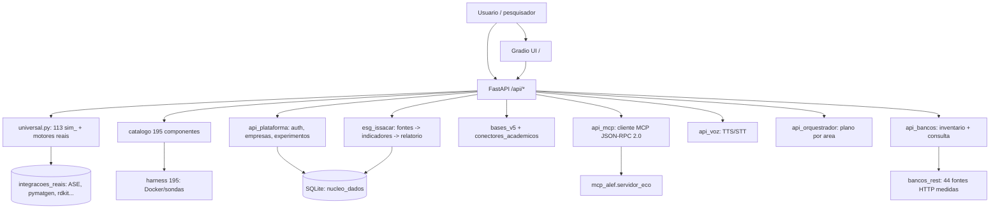

# Arquitetura da ALEF-TAV (gerada do app em execucao)

> Arquivo **gerado** por `python auditoria/mapa_arquitetura.py` em 01/11/2026 15:13.
> A fonte e' `app.api.openapi()` (contrato das rotas realmente montadas),
> nao um desenho. Regenere depois de qualquer mudanca de router.

## 1. Numeros medidos

| Item | Valor |
|---|---|
| caminhos publicados | **90** |
| operacoes HTTP (metodo x caminho) | **97** |
| modulos `.py` vivos na raiz | **109** |
| pacotes com `__init__.py` | **2** (`esg_issacar`, `mcp_alef`) |
| artefatos de auditoria (`auditoria_*`) | **9** |
| interface Gradio montada no mesmo ASGI | sim |

## 2. Diagrama de camadas



## 3. Rotas por area

| Area | caminhos | operacoes |
|---|---|---|
| README / diagnostico | 3 | 3 |
| Simuladores (113 funcoes sim_) | 13 | 13 |
| Catalogo (195 componentes) | 6 | 6 |
| Plataforma (auth, empresas, experimentos) | 13 | 16 |
| ESG Issacar | 17 | 18 |
| Dados e arquivos | 13 | 15 |
| MCP real (protocolo JSON-RPC) | 5 | 5 |
| MCP local (geradores) | 4 | 5 |
| Voz (STT/TTS) | 4 | 4 |
| Orquestrador cientifico | 4 | 4 |
| Bancos cientificos (bancos_rest) | 4 | 4 |
| Fontes academicas | 3 | 3 |
| Interface Gradio | 1 | 1 |

## 4. Inventario de rotas

| caminho | metodos | funcao | area |
|---|---|---|---|
| `/` | GET | `interface Gradio (mount)` | Interface Gradio |
| `/api/auth/eu` | GET | `auth_eu_api_auth_eu_get` | Plataforma (auth, empresas, experimentos) |
| `/api/auth/login` | POST | `auth_login_api_auth_login_post` | Plataforma (auth, empresas, experimentos) |
| `/api/auth/logout` | POST | `auth_logout_api_auth_logout_post` | Plataforma (auth, empresas, experimentos) |
| `/api/auth/registro` | POST | `auth_registro_api_auth_registro_post` | Plataforma (auth, empresas, experimentos) |
| `/api/banco/migrar` | POST | `banco_migrar_api_banco_migrar_post` | Plataforma (auth, empresas, experimentos) |
| `/api/banco/saude` | GET | `banco_saude_api_banco_saude_get` | Plataforma (auth, empresas, experimentos) |
| `/api/bancos` | GET | `bancos_listar_api_bancos_get` | Bancos cientificos (bancos_rest) |
| `/api/bancos/saude` | GET | `bancos_saude_api_bancos_saude_get` | Bancos cientificos (bancos_rest) |
| `/api/bancos/{base_id}` | GET | `bancos_detalhe_api_bancos__base_id__get` | Bancos cientificos (bancos_rest) |
| `/api/bancos/{base_id}/consultar` | POST | `bancos_consultar_api_bancos__base_id__consultar_post` | Bancos cientificos (bancos_rest) |
| `/api/buscar` | GET | `buscar_api_buscar_get` | README / diagnostico |
| `/api/componentes/ambiente` | GET | `ambiente_api_componentes_ambiente_get` | Catalogo (195 componentes) |
| `/api/componentes/grupo/{grupo}/construir` | POST | `construir_api_componentes_grupo__grupo__construir_post` | Catalogo (195 componentes) |
| `/api/componentes/lote/executar` | POST | `executar_lote_api_componentes_lote_executar_post` | Catalogo (195 componentes) |
| `/api/componentes/registro` | GET | `registro_geral_api_componentes_registro_get` | Catalogo (195 componentes) |
| `/api/componentes/{componente_id}` | GET | `detalhe_api_componentes__componente_id__get` | Catalogo (195 componentes) |
| `/api/componentes/{componente_id}/executar` | POST | `executar_api_componentes__componente_id__executar_post` | Catalogo (195 componentes) |
| `/api/dados/health` | GET | `saude_banco_dados_api_dados_health_get` | Dados e arquivos |
| `/api/diagnostico-montagem` | GET | `diagnostico_montagem_api_diagnostico_montagem_get` | README / diagnostico |
| `/api/empresas` | GET, POST | `listar_empresas_api_empresas_get` | Plataforma (auth, empresas, experimentos) |
| `/api/esg/autorizacoes` | POST | `registrar_autorizacao_api_esg_autorizacoes_post` | ESG Issacar |
| `/api/esg/empresas` | GET, POST | `listar_empresas_api_esg_empresas_get` | ESG Issacar |
| `/api/esg/empresas/{empresa_id}/analise` | GET | `analise_api_esg_empresas__empresa_id__analise_get` | ESG Issacar |
| `/api/esg/estado/{empresa_id}` | GET | `esg_estado_api_esg_estado__empresa_id__get` | ESG Issacar |
| `/api/esg/estado/{empresa_id}/historico` | GET | `esg_historico_api_esg_estado__empresa_id__historico_get` | ESG Issacar |
| `/api/esg/estado/{empresa_id}/transicao` | POST | `esg_transicao_api_esg_estado__empresa_id__transicao_post` | ESG Issacar |
| `/api/esg/fontes` | GET | `listar_fontes_api_esg_fontes_get` | ESG Issacar |
| `/api/esg/indicadores` | GET | `consultar_indicadores_api_esg_indicadores_get` | ESG Issacar |
| `/api/esg/indicadores-registrados` | GET | `indicadores_registrados_api_esg_indicadores_registrados_get` | ESG Issacar |
| `/api/esg/ingestao` | POST | `ingerir_api_esg_ingestao_post` | ESG Issacar |
| `/api/esg/lacunas` | GET | `lacunas_api_esg_lacunas_get` | ESG Issacar |
| `/api/esg/painel` | GET | `esg_painel_api_esg_painel_get` | ESG Issacar |
| `/api/esg/relatorios` | GET | `listar_relatorios_api_esg_relatorios_get` | ESG Issacar |
| `/api/esg/relatorios/gerar` | POST | `gerar_relatorio_api_esg_relatorios_gerar_post` | ESG Issacar |
| `/api/esg/relatorios/{relatorio_id}` | GET | `obter_relatorio_api_esg_relatorios__relatorio_id__get` | ESG Issacar |
| `/api/esg/saude` | GET | `saude_api_esg_saude_get` | ESG Issacar |
| `/api/esg/serie` | GET | `serie_api_esg_serie_get` | ESG Issacar |
| `/api/experimentos` | GET, POST | `listar_experimentos_api_experimentos_get` | Plataforma (auth, empresas, experimentos) |
| `/api/experimentos/{experimento_id}` | GET, PATCH | `obter_experimento_api_experimentos__experimento_id__get` | Plataforma (auth, empresas, experimentos) |
| `/api/exportacoes` | GET | `listar_exportacoes_api_exportacoes_get` | Dados e arquivos |
| `/api/exportacoes/{nome}` | GET | `baixar_exportacao_api_exportacoes__nome__get` | Dados e arquivos |
| `/api/exportar/csv` | POST | `exportar_csv_api_exportar_csv_post` | Dados e arquivos |
| `/api/exportar/excel` | POST | `exportar_excel_api_exportar_excel_post` | Dados e arquivos |
| `/api/exportar/grafico` | POST | `exportar_grafico_api_exportar_grafico_post` | Dados e arquivos |
| `/api/fontes/buscar` | GET | `buscar_fontes_api_fontes_buscar_get` | Fontes academicas |
| `/api/fontes/status` | GET | `status_fontes_api_fontes_status_get` | Fontes academicas |
| `/api/fontes/unpaywall` | GET | `consultar_unpaywall_api_fontes_unpaywall_get` | Fontes academicas |
| `/api/graficos/{nome}` | GET | `baixar_grafico_api_graficos__nome__get` | Dados e arquivos |
| `/api/ia/estado` | GET | `ia_estado_api_ia_estado_get` | Plataforma (auth, empresas, experimentos) |
| `/api/ia/uso` | GET | `ia_uso_api_ia_uso_get` | Plataforma (auth, empresas, experimentos) |
| `/api/mcp/minicurso` | POST | `mcp_minicurso_api_mcp_minicurso_post` | MCP local (geradores) |
| `/api/mcp/notebooklm` | GET | `mcp_notebooklm_capacidade_api_mcp_notebooklm_get` | MCP local (geradores) |
| `/api/mcp/notebooklm/exportar` | POST | `mcp_notebooklm_exportar_api_mcp_notebooklm_exportar_post` | MCP local (geradores) |
| `/api/mcp/obsidian` | GET, POST | `mcp_obsidian_listar_api_mcp_obsidian_get` | MCP local (geradores) |
| `/api/mcp/saude` | GET | `mcp_saude_api_mcp_saude_get` | MCP real (protocolo JSON-RPC) |
| `/api/mcp/servidores` | GET | `mcp_servidores_api_mcp_servidores_get` | MCP real (protocolo JSON-RPC) |
| `/api/mcp/servidores/{servidor_id}/ferramentas` | GET | `mcp_ferramentas_api_mcp_servidores__servidor_id__ferramentas_get` | MCP real (protocolo JSON-RPC) |
| `/api/mcp/servidores/{servidor_id}/ferramentas/{nome}/chamar` | POST | `mcp_chamar_api_mcp_servidores__servidor_id__ferramentas__nome__chamar_post` | MCP real (protocolo JSON-RPC) |
| `/api/mcp/servidores/{servidor_id}/testar` | POST | `mcp_testar_api_mcp_servidores__servidor_id__testar_post` | MCP real (protocolo JSON-RPC) |
| `/api/orquestrador/analise` | POST | `orquestrador_analise_api_orquestrador_analise_post` | Orquestrador cientifico |
| `/api/orquestrador/diagnostico` | GET | `orquestrador_diagnostico_api_orquestrador_diagnostico_get` | Orquestrador cientifico |
| `/api/orquestrador/plano` | POST | `orquestrador_plano_api_orquestrador_plano_post` | Orquestrador cientifico |
| `/api/orquestrador/saude` | GET | `orquestrador_saude_api_orquestrador_saude_get` | Orquestrador cientifico |
| `/api/relatorios/cientifico/{experimento_id}` | POST | `relatorio_cientifico_api_relatorios_cientifico__experimento_id__post` | Plataforma (auth, empresas, experimentos) |
| `/api/relatorios/esg/{empresa_id}` | POST | `relatorio_esg_api_relatorios_esg__empresa_id__post` | Plataforma (auth, empresas, experimentos) |
| `/api/resultados` | GET, POST | `listar_resultados_api_resultados_get` | Dados e arquivos |
| `/api/simuladores/adsorcao` | POST | `simular_adsorcao_api_simuladores_adsorcao_post` | Simuladores (113 funcoes sim_) |
| `/api/simuladores/catalogo` | GET | `listar_componentes_api_simuladores_catalogo_get` | Simuladores (113 funcoes sim_) |
| `/api/simuladores/catalogo-resumo` | GET | `resumo_catalogo_api_simuladores_catalogo_resumo_get` | Simuladores (113 funcoes sim_) |
| `/api/simuladores/catalogo/{component_id}` | GET | `obter_componente_api_simuladores_catalogo__component_id__get` | Simuladores (113 funcoes sim_) |
| `/api/simuladores/diagnostico-motores` | GET | `diagnostico_motores_api_simuladores_diagnostico_motores_get` | Simuladores (113 funcoes sim_) |
| `/api/simuladores/internos` | GET | `listar_simuladores_internos_api_simuladores_internos_get` | Simuladores (113 funcoes sim_) |
| `/api/simuladores/motores-conda` | GET | `listar_motores_conda_api_simuladores_motores_conda_get` | Simuladores (113 funcoes sim_) |
| `/api/simuladores/motores-conda/ambientes` | GET | `ambientes_conda_api_simuladores_motores_conda_ambientes_get` | Simuladores (113 funcoes sim_) |
| `/api/simuladores/motores-conda/prova` | GET | `provar_motores_conda_api_simuladores_motores_conda_prova_get` | Simuladores (113 funcoes sim_) |
| `/api/simuladores/motores-extra` | GET | `listar_motores_extra_api_simuladores_motores_extra_get` | Simuladores (113 funcoes sim_) |
| `/api/simuladores/motores-extra/prova` | GET | `provar_motores_extra_api_simuladores_motores_extra_prova_get` | Simuladores (113 funcoes sim_) |
| `/api/simuladores/motores-extra/{motor_id}` | POST | `executar_motor_extra_api_simuladores_motores_extra__motor_id__post` | Simuladores (113 funcoes sim_) |
| `/api/simuladores/universal` | POST | `executar_simulador_universal_api_simuladores_universal_post` | Simuladores (113 funcoes sim_) |
| `/api/tarefas` | GET, POST | `listar_tarefas_api_tarefas_get` | Dados e arquivos |
| `/api/tarefas/{tarefa_id}` | GET | `obter_tarefa_api_tarefas__tarefa_id__get` | Dados e arquivos |
| `/api/upload` | POST | `upload_arquivo_api_upload_post` | Dados e arquivos |
| `/api/upload/base64` | POST | `upload_base64_api_upload_base64_post` | Dados e arquivos |
| `/api/uploads` | GET | `listar_uploads_api_uploads_get` | Dados e arquivos |
| `/api/voz/saude` | GET | `voz_saude_api_voz_saude_get` | Voz (STT/TTS) |
| `/api/voz/stt` | POST | `voz_stt_api_voz_stt_post` | Voz (STT/TTS) |
| `/api/voz/tts` | POST | `voz_tts_api_voz_tts_post` | Voz (STT/TTS) |
| `/api/voz/vozes` | GET | `voz_vozes_api_voz_vozes_get` | Voz (STT/TTS) |
| `/health` | GET | `health_dados_health_get` | README / diagnostico |

## 5. Modulos vivos (109)

```
adaptador_modelos_v2 adaptadores_clientes_remotos adicionar_catalogo_ui ajustar_comparacao_bandgap ajustar_limiar_triagem anexar_log_evidencias api_bancos api_catalogo_simuladores api_componentes api_dados api_mcp api_motores_conda api_motores_diagnostico api_motores_extra api_orquestrador api_plataforma api_simulacoes api_voz aplicar_auditoria_metadados aplicar_triagem_relevancia app app_proposta_v2 atualizar_catalogo_instalados auditoria_metadados_local bancos_completos bancos_rest bases_v5 cache_busca catalogo_api_server catalogo_registry chaves_config conectores_academicos config_api conftest corrigir_ano_crossref corrigir_ano_pubmed corrigir_app corrigir_crossref corrigir_deduplicacao corrigir_http429 corrigir_metadados_crossref corrigir_regex_medline corrigir_resumo_ausente corrigir_tipos_documento doc_export estrategias_componentes executor_isolado exportadores fermilink_bridge funding_scrapers gemini gerar_auditorias gerar_log_funcoes graficos ia_conversa ia_orquestrador inspecionar_indentacao instalar_componentes integracao_modelos_v2 integracoes_reais integrar_comparador llm_client melhorias_panel modelos_adsorcao_v2 modelos_analiticos_v1 modelos_analiticos_v2 modulo_scopus motores_conda motores_extra nucleo_dados orquestrador_cientifico pdf_chat prova_motores_conda provedores_ia registro_componentes roteador_modelos_v2 roteador_motores_externos seguranca sondas_componentes tendencias test_bancos_rest test_busca_multibase test_componentes_api test_e2e_http test_esg_issacar test_executor_isolado test_fermilink_bridge test_integracao_modelos_v2 test_llm_client test_mcp_alef test_modelos_analiticos_v2 test_motor_real_prazo test_orquestrador test_plataforma_ak test_registro_componentes test_regressao_langmuir test_roteador_modelos_v2 test_seguranca_credenciais test_solido_emt test_ui_bancos test_universal_fluxo test_voz teste_componentes_195 tts universal validar_shell_run verificar_retorno voz voz_stt
```

## 6. Artefatos de auditoria presentes

* `auditoria_113_funcoes.csv`
* `auditoria_195_componentes.csv`
* `auditoria_bases_pesquisa.csv`
* `auditoria_bases_reais.csv`
* `auditoria_endpoints.csv`
* `auditoria_estatica_universal_20261012.json`
* `auditoria_funcoes_universal_20261012.json`
* `auditoria_integracoes_ferramentas.csv`
* `auditoria_resumo_final.json`

## 7. O que NAO esta provado

* motor externo so conta como executado quando ha numero conferido (`infra/inventario_simuladores.py`, `teste_componentes_195.py`);
* servidor MCP externo sem comando real fica `BLOQUEADA` em `mcp_alef.registro` — nao ha integracao fingida;
* TTS/STT dependem de `edge-tts`/`openai-whisper` instalados; sem eles a rota responde 503 com `requisito`;
* busca bibliografica depende de rede; `auditoria_bases_pesquisa.csv` registra o estado medido de cada base.
